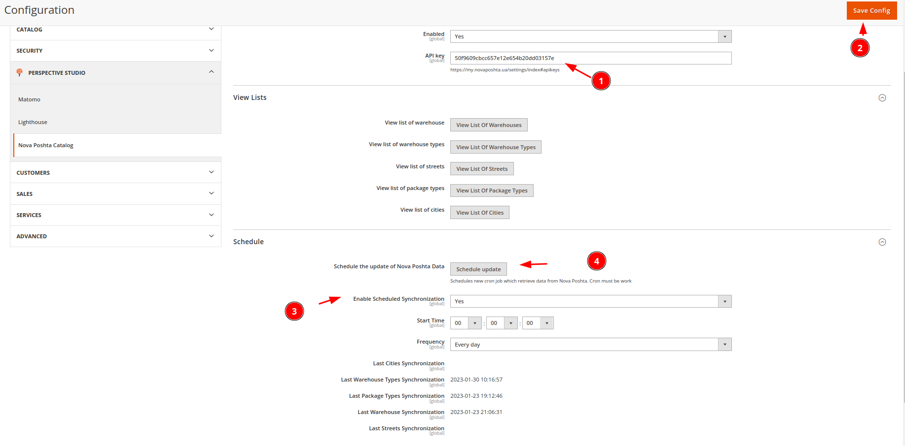

## Perspective Novaposhta Catalog 

### Install this package use the following steps:

1. Go to Magento 2 root directory.  
   1. For Magento 2 (from 2.4.5+) and direct installation from B use following command enter the following commands:  
       ```
       composer require perspectiveteam/module-novaposhtacatalog:"*"  
       ```
2. Wait while all dependencies are update. 
3. Make an ordinary setup for the module
   
   1. Add API key to the module configuration
   2. Save Configuration
   3. Enable cron jobs for the module
   4. You can manually schedule cron jobs for the module

### Area synchronization

Area synchronization updates existing records and inserts new ones. It never
automatically deletes areas that are absent from the API response. Empty lists,
invalid rows, duplicate references, and responses missing any stored reference
are rejected without changing the directory or its last successful sync date.
Concurrent writes are protected by Magento's configured lock manager.

If Nova Poshta permanently removes an area, review and remove the local record
explicitly before synchronizing again. On an empty directory, completeness cannot
be inferred from existing references; the first import validates the received rows.

