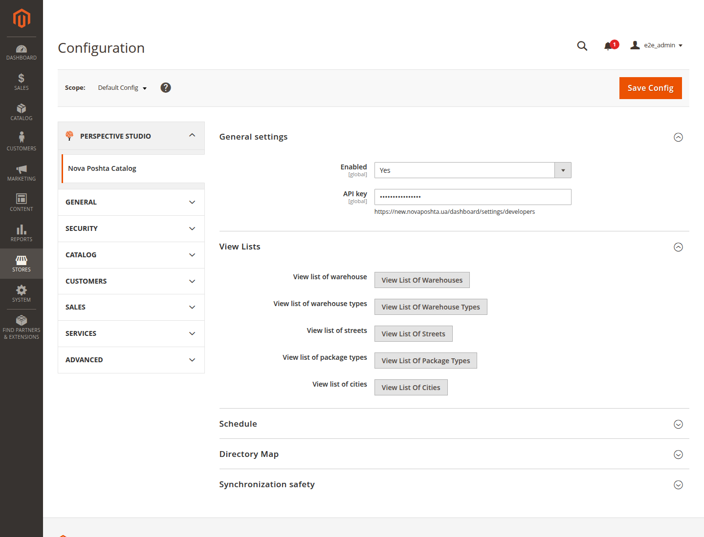
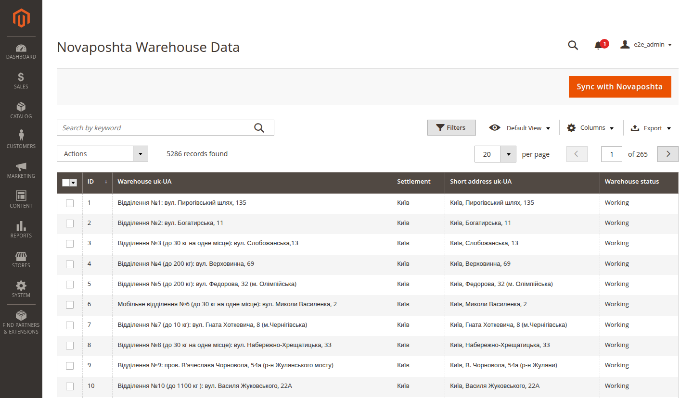
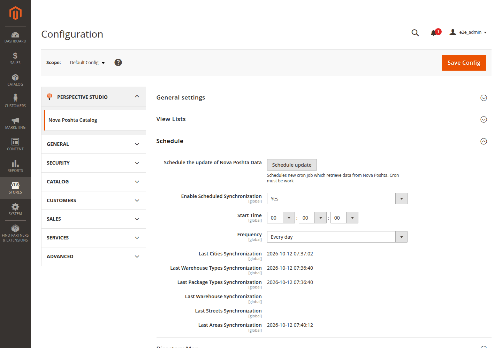
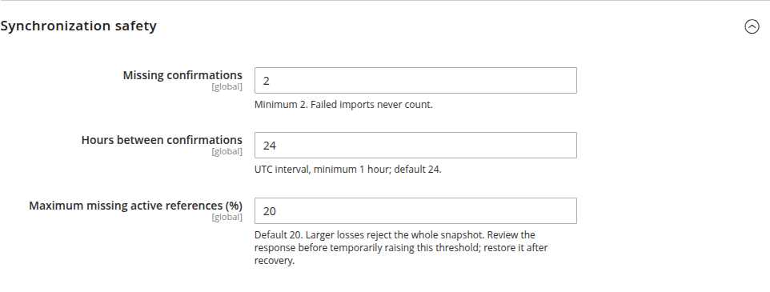
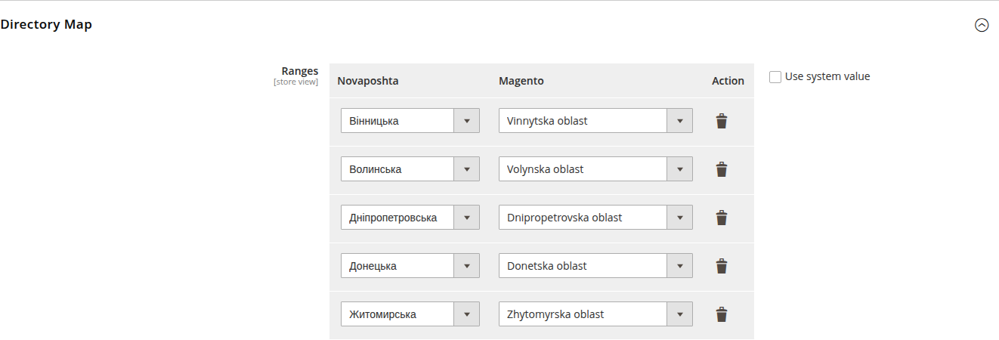

# Perspective Nova Poshta Catalog

**Українська** · [English](README.en.md)

Nova Poshta Catalog завантажує довідники Нової пошти у Magento: міста,
відділення, поштомати, вулиці, області й типи пакування. Дані зберігаються
у вашому магазині, де їх можуть використовувати модулі доставки та інші інтеграції.

В адмінпанелі можна переглядати довідники, налаштовувати оновлення за розкладом
і зіставляти області з регіонами Magento. API-ключ і всі налаштування модуля
зібрані в одному розділі. Модуль зберігає історію записів і перевіряє відповіді
API перед оновленням, щоб тимчасовий збій не прибрав доступні адреси.



*Stores → Configuration → Perspective Studio → Nova Poshta Catalog.*

## Довідники

| Довідник | Як його можна використовувати |
| --- | --- |
| Області | Зіставляти регіони Magento з областями Нової пошти |
| Міста | Шукати населені пункти й заповнювати адреси у ваших інтеграціях |
| Відділення та поштомати | Переглядати адреси, міста й статуси роботи |
| Типи відділень | Розрізняти типи точок видачі |
| Вулиці | Заповнювати адреси в інтеграціях із доставкою до дверей |
| Типи пакування | Отримувати дані про пакування для сумісних модулів доставки |

Для вибору доставки під час оформлення замовлення, розрахунку тарифів
і створення ТТН потрібен окремий модуль доставки.

## Перегляд відділень

У списку відділень видно назву, місто, адресу та статус роботи.
Можна відфільтрувати записи, вибрати потрібні колонки й переходити між сторінками.
Через **View Lists** також відкриваються списки міст, вулиць, типів відділень
і пакування. У таблицях додані колонки **Active**, **Missing confirmations**
і **Last seen** та дія **Deactivate selected** для вибраних записів.
Деактивація зберігає запис у базі. Якщо він знову надійде з API, синхронізація
може повернути його до активних.



*Довідник у демонстраційному магазині. Кількість записів залежить від завантажених даних.*

## Розклад оновлення

Виберіть час і частоту в **Schedule**, щоб модуль оновлював довідники автоматично.
Тут же видно дату останньої синхронізації кожного довідника.
Для виконання розкладу має працювати cron Magento.



*Налаштування щоденного оновлення.*

## Захист довідників під час оновлення

Якщо запис зникає з відповіді Нової пошти, модуль перевіряє його повторно.
За стандартних налаштувань запис стає неактивним після двох підтверджень
відсутності з інтервалом щонайменше 24 години. Невдалі або відхилені оновлення
не зараховуються. Локальний ID і дані зберігаються для звернень до історичних записів.

Якщо у відповіді бракує понад 20% активних записів, модуль відхиляє оновлення
відповідного довідника або міста ще до збереження змін. Цей поріг допомагає
захистити дані від неповних відповідей API.

Параметри доступні в **Default Config → Synchronization safety**:

| Налаштування | Типове значення | Що визначає |
| --- | --- | --- |
| Missing confirmations | 2 | Скільки підтверджень відсутності потрібно для деактивації |
| Hours between confirmations | 24 | Мінімальну кількість годин між підтвердженнями |
| Maximum missing active references (%) | 20 | Яку частку відсутніх активних записів можна прийняти |



*Стандартні значення захисту синхронізації.*

Вибірки для нових адрес враховують активність запису та пов'язаних довідників.
Відділення також має працювати за статусом Нової пошти: статус, відмінний від
**Working**, робить його неактивним під час імпорту без очікування підтверджень.
Коли запис повертається в API, модуль скидає лічильник відсутності й відновлює
активність; для відділення при цьому потрібен статус **Working**.

Якщо API обмежує частоту запитів або виникає тимчасова помилка з'єднання,
модуль робить паузу й повторює запит. Кількість спроб і загальний час очікування
обмежені. Якщо повторні спроби не допомогли, дані поточного довідника або міста
залишаються без змін; синхронізацію можна повторити пізніше.

## Зіставлення областей

У **Directory Map** виберіть, якій області Нової пошти відповідає регіон Magento.
Модуль уже містить початкові відповідності. Їх можна змінити в адмінпанелі
для всього магазину, окремого вебсайту або Store View, без редагування коду.



*Область Нової пошти й відповідний регіон Magento.*

## Як почати

Коли розробник встановить модуль:

1. Відкрийте **Stores → Configuration → Perspective Studio → Nova Poshta Catalog**.
2. Виберіть **Default Config**, у **General settings** увімкніть модуль і введіть
   API-ключ із [кабінету Нової пошти](https://new.novaposhta.ua/dashboard/settings/developers).
3. У **Schedule** увімкніть **Enable Scheduled Synchronization**, виберіть час
   і частоту, натисніть **Save Config**.
4. Дочекайтеся синхронізації та відкрийте довідники через **View Lists**.
5. Перевірте **Directory Map**, коли модуль завантажить області.

Для першого імпорту відділень і вулиць може знадобитися більше часу:
модуль обробляє дані багатьох міст. API-ключ на скриншоті прихований.

## Для розробника

### Вимоги

Для роботи потрібен API-ключ Нової пошти.

### Встановлення

Виконайте з кореня Magento:

```bash
composer require perspectiveteam/module-novaposhtacatalog
php bin/magento module:enable Perspective_NovaposhtaCatalog
php bin/magento setup:upgrade
php bin/magento cache:clean config layout block_html
```

<details>
<summary><strong>Інтеграція та синхронізація</strong></summary>

### Точки інтеграції

| Компонент | Призначення |
| --- | --- |
| [Api/](Api/) | Репозиторії областей, міст, відділень і вулиць та інтерфейси даних |
| [Helper/Config.php](Helper/Config.php) | `getDirectoryMap($storeId)` повертає `[regionCode => areaRef]` для вибраного scope |
| [Service/DirectorySyncMapper.php](Service/DirectorySyncMapper.php) | `getRegionIdToAreaRefMap()` зіставляє ID регіонів Magento з Ref областей |
| [Model/Availability.php](Model/Availability.php) | Фільтрує доступні записи для нових виборів з урахуванням пов'язаних довідників |
| [Model/Update/SyncPolicy.php](Model/Update/SyncPolicy.php) | Перевіряє поріг відсутніх записів і керує деактивацією |
| [Service/HTTP/RateLimitRetry.php](Service/HTTP/RateLimitRetry.php) | Повторює запити після обмеження частоти або транспортних помилок |
| [etc/db_schema.xml](etc/db_schema.xml) | Локальні таблиці довідників |
| [Test/Unit/](Test/Unit/) | Тести Directory Map, перевірок синхронізації та повторних запитів |

Отримуйте репозиторії через Magento DI. Плагін до
`Magento\Directory\Model\Region::getName()` повертає українські назви
для відомих кодів регіонів UA.

### Доступність і збереження історії

Вибірки міст за назвою, відділень і вулиць за містом використовують
`Availability`. Місто потребує активної області; вулиця й відділення також
потребують активного міста. Для відділення перевіряються активність його типу
та статус `Working`. Інтеграціям із власними колекціями слід явно застосовувати
цей фільтр для нових виборів.

Загальні `getList(SearchCriteria)` і пошук за ID або Ref зберігають доступ до
історії та можуть повертати неактивні записи. Усі шість таблиць містять
`is_active`, `last_seen_at`, `missing_successful_syncs` і `last_missing_at`.
Масова деактивація в Admin не є постійним виключенням із синхронізації:
наступний імпорт наявного в API запису може активувати його знову.

### Як працює синхронізація

- Cron-група: `perspective_novaposhta_catalog`; job: `update_novaposhta_catalog`.
  Модуль імпортує довідники послідовно: типи відділень, пакування, області,
  міста, відділення, вулиці.
- Data patch під час встановлення додає початкове завдання cron.
  Збереження налаштувань Schedule з увімкненим **Enable Scheduled Synchronization**
  формує регулярний розклад із вибраним часом і частотою.
- Збереження **Enable Scheduled Synchronization = No** очищає cron-вираз.
  Перед кожним запуском job перевіряє цей прапорець: вимкнення блокує також
  раніше заплановані завдання, запуск через кнопку **Schedule the update**
  і початкове завдання після встановлення. Уже запущений імпорт завершується.
  Повторне ввімкнення та збереження відновлює розклад із вибраним часом і частотою.
  Прямі ручні імпорти залишаються доступними.
- Варіанти **7 days**, **15 days** і **30 days** задають крок дня місяця
  у cron-виразі. Це не фіксований інтервал між запусками.
  Дати синхронізації зберігаються в UTC.
- `DirectorySnapshot` перевіряє рядки й унікальність Ref перед записом,
  зберігає локальні ID та використовує транзакції й Magento Lock Manager.
  Порожні відповіді відхиляються для цілих довідників; порожній список
  відділень або вулиць окремого міста проходить перевірку порога відсутності.
- Поріг відсутніх активних Ref перевіряється до запису даних і лічильників.
  Прийнята відповідь оновлює `last_seen_at` для наявних записів і скидає
  їхні підтвердження відсутності. Відсутні записи деактивуються за `SyncPolicy`
  зі збереженням даних. Невдалі та відхилені імпорти не змінюють лічильники;
  повторний запуск раніше заданого інтервалу не додає підтвердження.
- Відділення й вулиці обробляються по містах. Перед збереженням міста
  `PagedDirectory` завантажує всі сторінки та перевіряє їхню повноту
  й узгодженість `totalCount`. Якщо місто не вдалося обробити, зміни
  для нього не записуються; дані раніше оброблених міст залишаються збереженими.
- `RateLimitRetry` повторює той самий запит або сторінку при HTTP 429,
  повідомленні API `too many requests` або транспортній помилці.
  Ліміт становить 5 спроб загалом і 180 секунд сумарних пауз між ними,
  без часу виконання запитів. Враховується `Retry-After`; за його відсутності
  затримка зростає між спробами.
- Ручні оновлення у Store View та кнопки синхронізації в таблицях запускають
  імпорт у межах HTTP-запиту. Для великих довідників використовуйте cron.
- Успішний статус загального cron-завдання не означає, що всі довідники
  оновилися. Перевіряйте дані та журнали Magento: сама дата оновлення
  не підтверджує повноту імпорту для всіх міст.
- Доступ до конфігурації: `Perspective_NovaposhtaCatalog::settings`.
  Списки відкриваються у Default Config; окремої таблиці областей в Admin немає.
  Приховуйте API-ключі в логах і матеріалах, які передаєте іншим.

</details>

## Ліцензія

[MIT](LICENSE.md) · Perspective Studio
